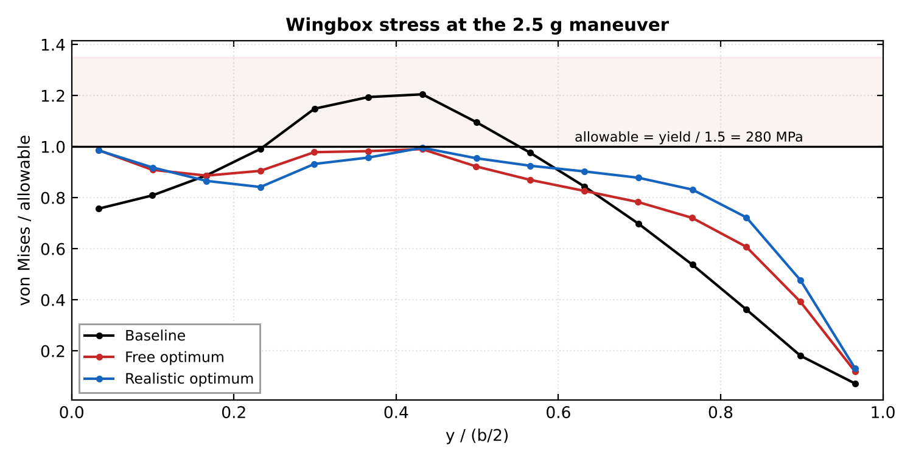
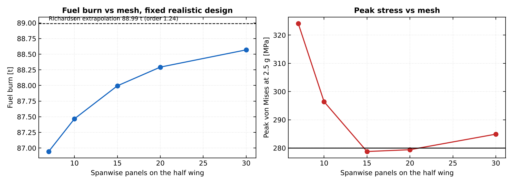
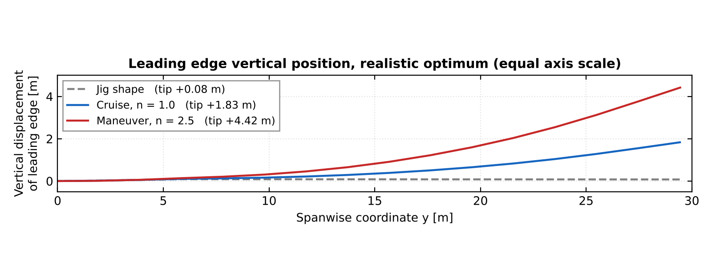

# Aerostructural optimization of the uCRM wing

Fuel burn minimization of a uCRM based transport wing with OpenAeroStruct, followed by an engineering review of the optimum and independent checks.


## Problem

| Item | Value |
|---|---|
| Geometry | uCRM based wing shipped with OpenAeroStruct, semi-span 29.4 m, AR 8.4 |
| Model | VLM (31 spanwise by 3 chordwise nodes) coupled with a wingbox beam FEM (SC(2)-0612, 10% to 60% chord) |
| Cruise | Mach 0.85, rho = 0.348 kg/m³, CL = 0.5 |
| Maneuver | Mach 0.64, sea level, n = 2.5, L = W |
| Objective | Breguet fuel burn over 14,307 km, TSFC 0.53 1/h |
| Design variables | 4 twist, 4 t/c, 4 spar thickness and 4 skin thickness control points, both angles of attack, fuel mass |
| Constraints | 2.5 g von Mises stress (Al 7075, 420 MPa / 1.5 = 280 MPa), fuel volume, trim, fuel mass consistency |
| Optimizer | OpenMDAO SLSQP, coupled adjoint gradients, tol 1e-6 |
| Realistic variant | adds monotonic t/c and twist from tip to root |

## Results

| | Baseline | Free optimum | Realistic optimum |
|---|---|---|---|
| Fuel burn [t] | 92.46 | 87.26 (-5.6%) | **87.99 (-4.8%)** |
| Cruise L/D | 20.95 | 22.16 | 21.93 |
| Wingbox mass [t] | 19.60 | 21.12 | 20.45 |
| Peak von Mises at 2.5 g [MPa] | 337 (fails) | 277 | 279 |
| Fuel volume margin [m³] | -2.0 (fails) | 2.1 | 6.7 |
| Span efficiency, far field fit | 0.830 | 0.975 | 0.944 |

The initial design is not feasible: the wingbox is 20% over the allowable stress at 2.5 g and the fuel does not fit in the wing.

## Engineering review

1. **The free optimum exploits the parameterization.** It produces a zigzag twist and a local t/c bump to 0.15 at two thirds of the semi-span. Monotonic t/c and twist constraints remove both at a cost of 0.8% in fuel burn.
2. **Multiple local optima.** The free problem converged to 89.04 t from the baseline start and to 87.26 t from a different start. A single SLSQP run is not enough.
3. **Induced drag accounting.** The near field CDi implies e = 1.06 to 1.09, above the planar limit of 1.0. A far field Fourier fit of the computed span loading gives e = 0.94 to 0.97, so near field induced drag is about 13% low.
4. **Mesh dependence.** With the realistic design fixed, fuel burn converges toward 88.99 t (Richardson, order 1.24), and peak stress rises to 285 MPa at 61 nodes, 1.8% above the allowable. Optimize at 41 nodes or more, or keep a 2% stress margin.
5. **Bookkeeping.** Fuel burn recomputed by hand from the Breguet equation matches the model output to rounding.

| Span loading | Stress at 2.5 g |
|---|---|
|  |  |
| **Design variables** | **Mesh study** |
|  |  |



Full write-up: [uCRM_Aerostructural_Optimization_Report.pdf](uCRM_Aerostructural_Optimization_Report.pdf)

## Reproduce

```bash
pip install -r requirements.txt
python study.py     # all optimizations and analyses, a few minutes on a laptop
python post.py      # independent checks (results/checks.json) and plots
python render.py    # 3D render (PyVista, off screen)
python report.py    # PDF report
```

| File | Purpose |
|---|---|
| `ucrm_model.py` | uCRM wingbox aerostructural model, adapted from the OpenAeroStruct example |
| `study.py` | baseline, free, realistic, multistart and mesh study runs |
| `post.py` | Trefftz span efficiency, Breguet check, Richardson extrapolation, plots |
| `render.py` | 3D render of the deformed wing colored by stress |
| `report.py` | PDF report |
| `results/` | JSON summaries and NumPy arrays for every run |

## Limitations

Low fidelity: VLM with empirical viscous and wave drag, beam wingbox, no buckling or flutter constraint, single cruise point. Fuselage, tail and airfoil shape in the render are illustrative only. All inputs are public.

OpenAeroStruct 2.12.1, OpenMDAO 3.45.2, Python 3.13.
