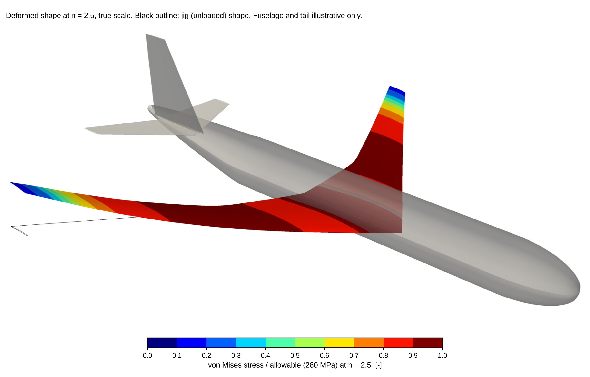
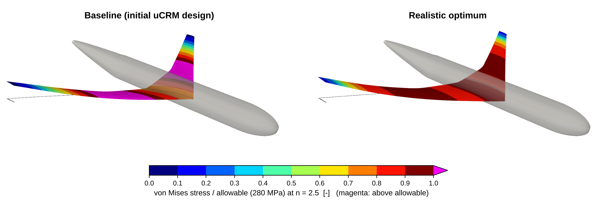
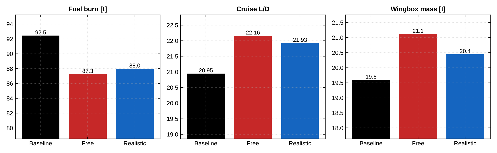
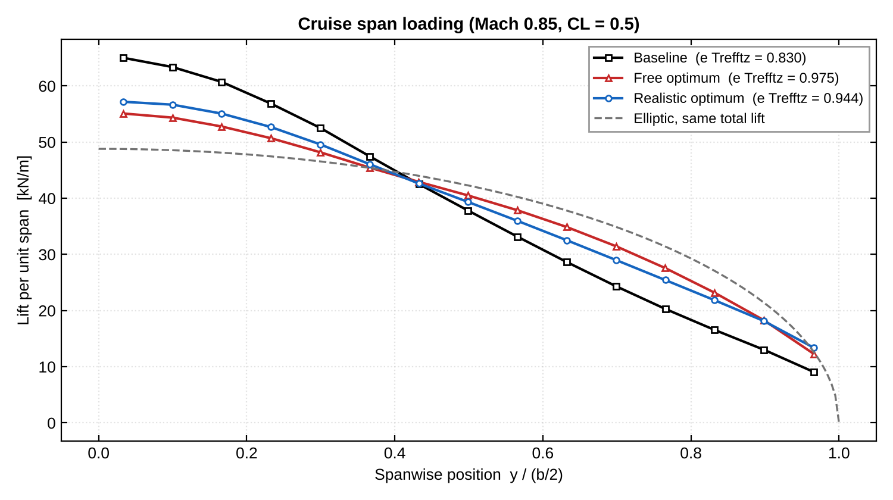
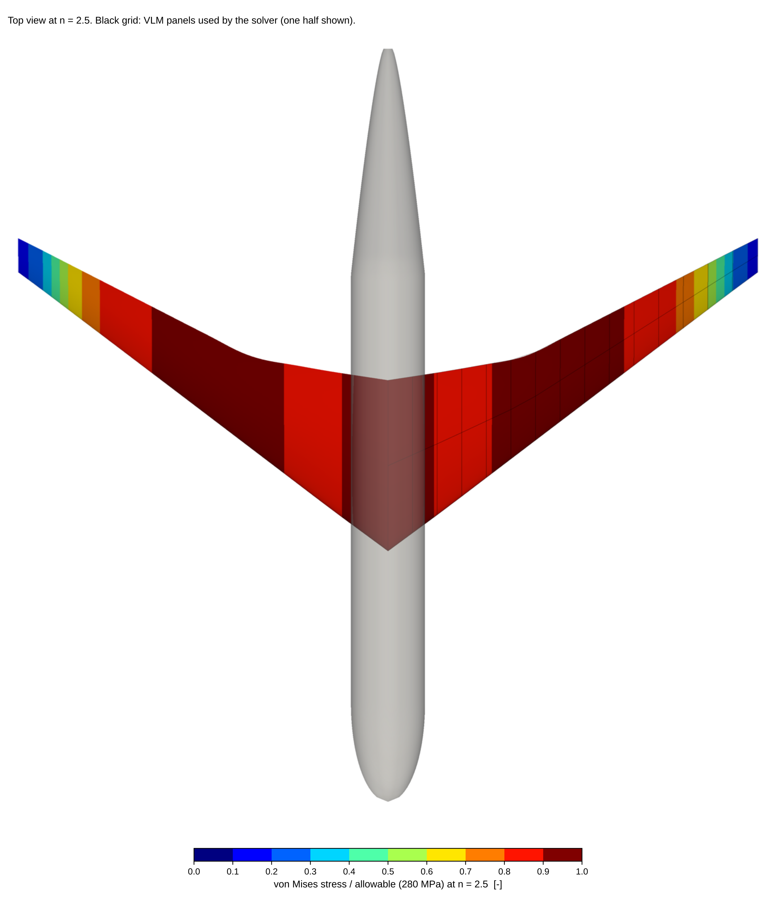
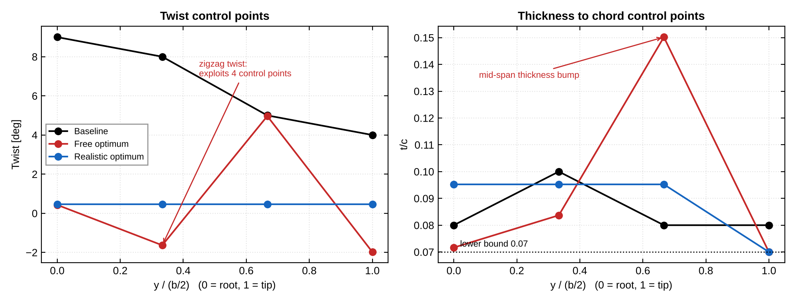

# Aerostructural Optimization of the uCRM Wing

**Fuel burn minimization of a transport wing with OpenAeroStruct, followed by an engineering review of the optimum and independent verification of the results.**



| Fuel burn | Cruise L/D | Peak stress at 2.5 g | Tip deflection at 2.5 g |
|:---:|:---:|:---:|:---:|
| **87.99 t** (-4.8%) | **21.93** (+4.7%) | **279 MPa** (limit 280, baseline 337) | **4.35 m** (1.76 m in cruise) |

---

## Why this study

An optimizer always returns a number. The engineering question is whether that number can be trusted. This repository optimizes a realistic transport wing and then reviews the optimum the way an engineer would review any proposed design: Is it feasible? Is it physically plausible? Does it exploit weaknesses of the model? Does it survive a finer mesh? Can the headline number be reproduced by hand?

Five issues were found, documented and corrected. They are the kind of issues that separate a credible result from a misleading one.

---

## 1. The problem

| Item | Value |
|---|---|
| Geometry | uCRM based wing shipped with OpenAeroStruct, semi-span 29.4 m, aspect ratio 8.4, area 408 m² |
| Aerodynamics | Vortex lattice method, 31 spanwise by 3 chordwise nodes, viscous drag from skin friction and form factor, wave drag from the Korn equation |
| Structure | Wingbox beam FEM from the 10% to 60% chord portion of the NASA SC(2)-0612 airfoil |
| Material | Aluminum 7075: E = 73.1 GPa, yield 420 MPa, safety factor 1.5, allowable 280 MPa |
| Cruise point | Mach 0.85, rho = 0.348 kg/m³, CL = 0.5 |
| Maneuver point | Mach 0.64, sea level, load factor 2.5, lift equal to weight |
| Objective | Breguet fuel burn, range 14,307 km, TSFC 0.53 1/h |
| Design variables (18) | 4 twist, 4 t/c, 4 spar thickness, 4 skin thickness control points, 2 angles of attack, plus fuel mass |
| Constraints | 2.5 g stress (KS aggregated), fuel volume, trim at both points, fuel mass consistency |
| Optimizer | OpenMDAO SLSQP with coupled adjoint gradients, tolerance 1e-6 |
| Realistic variant | adds monotonic t/c and twist from tip to root |

---

## 2. The starting design is not feasible

The initial uCRM design, trimmed to the same flight conditions, exceeds the stress allowable by 20% between 25% and 50% semi-span at 2.5 g, and the fuel it needs does not fit in the wing (-2.0 m³). The optimizer has to add structure where the wing is overstressed and recover the weight through better aerodynamics.




---

## 3. Results

| | Baseline | Free optimum | Realistic optimum |
|---|:---:|:---:|:---:|
| Fuel burn [t] | 92.46 | 87.26 (-5.6%) | **87.99 (-4.8%)** |
| Cruise L/D | 20.95 | 22.16 | 21.93 |
| Wingbox mass [t] | 19.60 | 21.12 | 20.45 |
| Peak von Mises at 2.5 g [MPa] | 337 (fails) | 277 | 279 |
| Fuel volume margin [m³] | -2.0 (fails) | 2.1 | 6.7 |
| CDi / CDv / CDw [counts] | 101 / 60 / 0.4 | 87 / 60 / 1.0 | 89 / 60 / 1.1 |
| Span efficiency, far field fit | 0.830 | 0.975 | 0.944 |



The baseline is strongly root loaded. Both optima move lift outboard toward the elliptic distribution and stop short of it, because outboard lift raises the root bending moment and therefore wingbox weight. That is the expected aerostructural compromise.





---

## 4. Engineering review of the optimum

### 4.1 The free optimum exploits the parameterization

With only four control points and one cruise condition, the free optimizer produced a zigzag twist (0.4, -1.6, 5.0, -2.0 deg from root to tip) and a local thickness bump to t/c = 0.15 at two thirds of the semi-span, between 0.08 and 0.07 sections. The bump buys wingbox depth and fuel volume where it is cheap in wave drag at this single Mach number. No engineer would release either shape. Monotonic t/c and twist constraints remove both **at a cost of only 0.8% in fuel burn**, the price of realism in this model.



### 4.2 Multiple local optima

The same free problem converged to 89.04 t from the baseline start and to 87.26 t from a different start. A 2% spread between two converged SLSQP runs means a single run cannot be reported as the optimum. Multistart is required.

### 4.3 Induced drag gives a physically impossible span efficiency

The near field induced drag implies e = CL² / (π AR CDi) = 1.06 to 1.09. Munk's theorem limits a planar wing to e = 1.0, and the bending is too small to justify the excess. An independent far field estimate, a four term Fourier fit of the computed span loading, gives 0.94 to 0.97. The near field integration with three chordwise nodes underestimates induced drag by about 13%, so absolute fuel burn is optimistic, although the ranking between designs holds.

### 4.4 The stress constraint is met only on the optimization mesh

With the realistic design held fixed and both flight points retrimmed at 15 to 61 spanwise nodes, fuel burn converges at order 1.24 toward 88.99 t by Richardson extrapolation (the 31 node result is 1.1% low). The peak stress at 61 nodes is 285 MPa, **1.8% above the allowable**. A design sitting exactly on a constraint at the optimization mesh is not guaranteed feasible on a finer one: optimize at 41 nodes or more, or carry a 2% margin.


### 4.5 Bookkeeping check

Fuel burn recomputed by hand from the Breguet equation, W_fuel = W_end (exp(R c / (V L/D)) - 1), with W_end = 128 t + 15 t reserve + 20 t engines + wing structural mass, matches the model to rounding for all three designs.


---

## 5. Checklist for judging any optimized wing

1. Every constraint satisfied with a stated margin, also on a finer mesh.
2. Design variables smooth and monotonic where physics and manufacturing require it.
3. Span efficiency at or below one for a planar wing, checked in the far field.
4. Span loading between elliptic and root loaded, consistent with the structural weight trade.
5. Wingbox fully stressed where weight was minimized, lightly stressed near the tip.
6. The same optimum, within tolerance, from more than one starting point.
7. Fuel burn reproducible by hand from L/D and weights.

---

## Reproduce

```bash
pip install -r requirements.txt
python study.py     # all optimizations and analyses, a few minutes on a laptop
python post.py      # independent checks (results/checks.json) and plots
python render.py    # 3D renders (PyVista, off screen)
python report.py    # PDF report
```

| File | Purpose |
|---|---|
| `ucrm_model.py` | uCRM wingbox aerostructural model, adapted from the OpenAeroStruct example |
| `study.py` | baseline, free, realistic, multistart and mesh study runs |
| `post.py` | far field span efficiency, Breguet check, Richardson extrapolation, plots |
| `render.py` | 3D renders of the deformed wing colored by stress |
| `report.py` | PDF report |
| `results/` | JSON summaries and NumPy arrays for every run |

Full write-up: [uCRM_Aerostructural_Optimization_Report.pdf](uCRM_Aerostructural_Optimization_Report.pdf)

## Limitations

Low fidelity model: VLM with empirical viscous and wave drag, beam wingbox, no buckling or flutter constraint, single cruise point. Fuselage, tail and airfoil shape in the renders are illustrative only. All inputs are public.

OpenAeroStruct 2.12.1 · OpenMDAO 3.45.2 · PyVista 0.49 · Python 3.13

**Enzo Alves Zanatta**, Mechanical Engineer · [LinkedIn](https://www.linkedin.com/in/enzozanatta)
